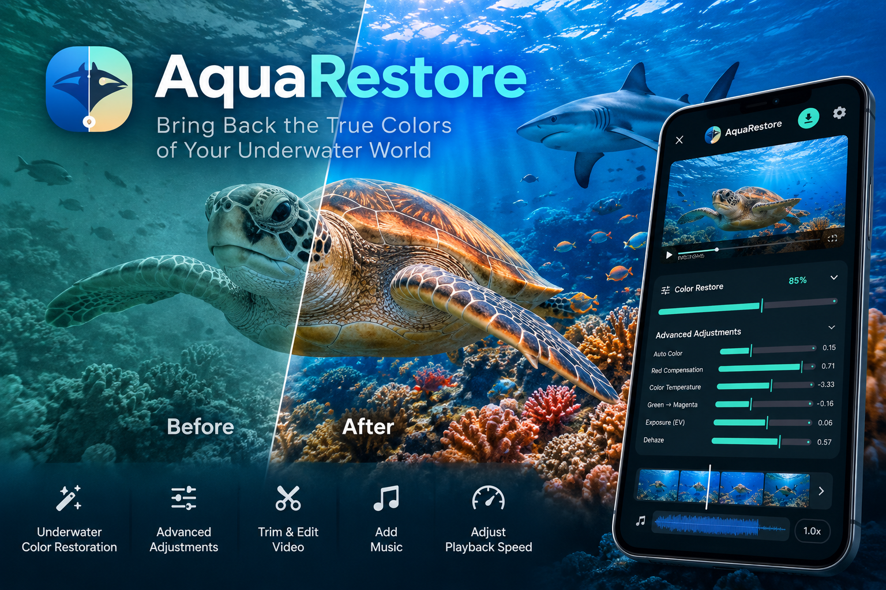

**English** | [繁體中文](README.zh_TW.md)

# AquaRestore &nbsp;  

AquaRestore brings back the colors that water takes out of your underwater videos and photos. Pick a clip, and the
app recommends a restoration you can fine-tune with a single slider, then export at the quality you choose. All
processing happens on your Android phone or iPhone.

## Features

- **Restoration recommended for each clip.** The app analyzes the colors on your device, not with a cloud service,
  and recommends red recovery, white balance, exposure, dehaze, clarity and shadow settings. It tells deep blue or
  green water, hazy water and dim footage apart. A video gets one set of settings for the whole clip, so the colors
  stay steady from frame to frame.
- **One slider.** **Restore intensity** scales every setting together, from 0% (the original) to 100% (the full
  recommendation). Hold **Hold to compare** to see the original, or open the full-screen viewer.
- **Advanced adjustments.** Auto levels, red recovery, protect cool water, warmth, green/magenta tint, exposure,
  dehaze, clarity, contrast, saturation and shadows.
- **Video tools.** Play and export at 0.5×, 1×, 2× or 4× with the pitch kept. Trim on a filmstrip of restored frames,
  set the original sound's volume, and add background music with its own volume.
- **Export your way.** Recommended, Original or Custom resolution, frame rate and quality, with an estimated file
  size before you start. Videos are MP4 (H.264 or HEVC); photos are JPEG or PNG.
- **HDR.** HDR10 and HLG videos stay HDR on compatible devices (on Android, Android 13 or later with a suitable
  encoder). Elsewhere they are converted and exported as SDR.
- **Before and after.** After an export, swipe through before/after comparison previews and share them.
- **Batch restore.** Restore up to 100 photos at once on Android, or 30 on iPhone, each with its own recommended
  restoration. Batch video restoration is experimental: up to 20 videos on Android, or 5 on iPhone.
- **Exports in the background** on Android, with a notification. On iPhone, keep the app open while it exports.
- **English and Traditional Chinese**, with light, dark and system themes.

### Good to know

- Colors that the water absorbed completely cannot be fully recovered. Clips that mix scenes, very dark footage and
  strong colored lights may need a lower intensity.
- Restoring color means re-encoding, so even **Original** export is not bit-for-bit lossless.
- HDR10+ and Dolby Vision dynamic metadata is not kept. On Android, these files are not accepted. On iPhone, Dolby
  Vision video recorded by iPhones is exported as HLG.
- Photo EXIF and GPS metadata is not kept.
- Smoothness depends on your device. Very large or HDR videos may preview from a lighter copy first; exports always
  use the original file.

## Download

| Device | Get AquaRestore | Requires |
| :--- | :--- | :--- |
| Android | [Google Play](https://play.google.com/store/apps/details?id=com.aquarestore.app), or [AquaRestore.apk](https://github.com/daocha/AquaRestore/releases/latest/download/AquaRestore.apk) from [GitHub Releases](https://github.com/daocha/AquaRestore/releases/latest) | Android 10 or later |
| iPhone | [App Store](https://apps.apple.com/app/id6829494205) | iOS 16 or later |

**About the GitHub APK.** Each release has the APK and a `SHA256SUMS` file to check the download against. The GitHub
version quietly checks this repository for a new release when it opens, at most every six hours. When one is
available, **Settings** shows **Update now**; the download is checked before Android asks you to confirm the
install. The Google Play and App Store versions update through their stores.

## Privacy

Your photos and videos are processed on your device and are not sent to the developer. AquaRestore has no account,
analytics, advertising or tracking, and does not sell personal data. The app goes online only for the purposes in
the privacy policy: update checks in the GitHub version, and a referral service that receives a hashed device
identifier. Read the full [privacy policy](PRIVACY.md).

## Report a problem

Open an [issue](https://github.com/daocha/AquaRestore/issues) to report a bug or suggest an improvement. Issues are
public, so leave out personal information and private media.

To include logs, tap the version number in **Settings** ten times to unlock the developer tools, then reproduce the
problem: the app writes its detailed log only while they are on. Use **Save logs** to keep it:

- **Android:** saved files go to `Download/AquaRestore-analysis`.
- **iPhone:** saved files go to the Files app, under On My iPhone › AquaRestore.

The tools stay on until the next app update, or until you switch them off in Settings.

## About this repository

This repository hosts AquaRestore's releases and privacy policy. The source code is not public. Third-party
libraries used by the app, such as AndroidX Media3, Jetpack Compose, libjpeg-turbo and skcms, remain under their own
licenses. The iOS app is based in part on the work of the Independent JPEG Group.
