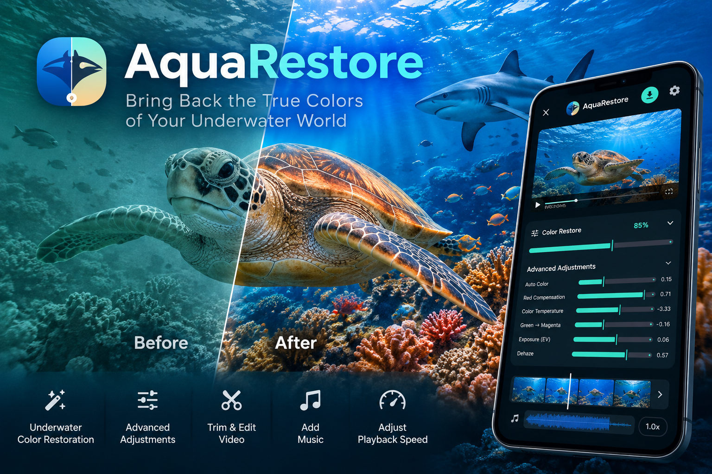

[English](README.md) | **繁體中文**

# AquaRestore &nbsp;  

AquaRestore 找回被海水吃掉的色彩。選擇水下影片或照片，App 會推薦還原設定，只需一個滑桿即可微調，再以你選擇的畫質匯出。
所有處理都在你的 Android 手機或 iPhone 上完成。

## 功能

- **為每段素材推薦還原設定。** 在裝置上分析色彩（不使用雲端服務），推薦紅色補償、白平衡、曝光、去霧、清晰度及陰影設定，
  並能分辨深藍或深綠的水域、混濁的水與昏暗的畫面。整段影片使用同一組設定，色彩不會逐格忽明忽暗。
- **一個滑桿。** 「還原強度」同時調整所有參數，0% 為原色，100% 為完整推薦校正。按住「對比原片」即可看原色，也可開啟全螢幕檢視。
- **進階調整。** 自動色階、紅色補償、保護冷色水域、色溫、綠／洋紅偏色、曝光、去霧、清晰度、對比、飽和度、陰影。
- **影片工具。** 以 0.5×、1×、2×、4× 播放與匯出，音調不變。在已調色的影格縮圖上剪輯長度，調整原聲音量，並加入可獨立調整音量的背景音樂。
- **自由匯出。** 「建議」、「原始」或「自訂」解析度、影格率與畫質，開始前會顯示預估檔案大小。影片為 MP4（H.264 或 HEVC），照片為 JPEG 或 PNG。
- **HDR。** 在相容裝置上，HDR10 與 HLG 影片會保持 HDR（Android 需 Android 13 以上及合適的編碼器）；其他裝置則轉換為 SDR 匯出。
- **前後對比。** 匯出後可滑動瀏覽還原前後的對比預覽並分享。
- **批次還原。** Android 一次最多還原 100 張照片，iPhone 最多 30 張，每張都套用各自的推薦還原。批次還原影片為實驗功能：
  Android 最多 20 段，iPhone 最多 5 段。
- **背景匯出**（Android），並顯示通知。iPhone 匯出時請保持 App 開啟。
- **繁體中文與 English**，提供淺色、深色及跟隨系統的主題。

### 注意事項

- 完全被水吸收的顏色無法完整還原。多場景拼接、非常昏暗的畫面或強烈彩色燈光，可能需要調低強度。
- 還原色彩需要重新編碼，因此即使選擇「原始」匯出，也不是逐位元無損。
- 不保留 HDR10+ 與 Dolby Vision 的動態中繼資料。Android 不接受這類檔案；iPhone 錄製的 Dolby Vision 影片會以 HLG 匯出。
- 不保留照片的 EXIF 與 GPS 中繼資料。
- 流暢度取決於裝置。非常大或 HDR 的影片可能先以較輕的副本預覽；匯出一律使用原始檔案。

## 下載

| 裝置 | 取得 AquaRestore | 系統需求 |
| :--- | :--- | :--- |
| Android | [Google Play](https://play.google.com/store/apps/details?id=com.aquarestore.app)，或從 [GitHub Releases](https://github.com/daocha/AquaRestore/releases/latest) 下載 [AquaRestore.apk](https://github.com/daocha/AquaRestore/releases/latest/download/AquaRestore.apk) | Android 10 以上 |
| iPhone | [App Store](https://apps.apple.com/app/id6829494205) | iOS 16 以上 |

**關於 GitHub APK。** 每個版本都附有 APK 及用來核對下載檔案的 `SHA256SUMS`。GitHub 版本會在開啟時於背景檢查此儲存庫是否有新版本，
最多每六小時一次。有新版本時，「設定」會顯示「立即更新」；下載的檔案經檢查後，Android 會請你確認安裝。Google Play 與 App Store
版本則透過各自的商店更新。

## 隱私

你的照片與影片都在裝置上處理，不會傳送給開發者。AquaRestore 沒有帳號、分析、廣告或追蹤，也不會出售個人資料。App 只會為隱私權政策
所列的用途連線：GitHub 版本的更新檢查，以及接收雜湊裝置識別碼的推薦服務。完整內容請見[隱私權政策](PRIVACY.md)（英文）。

## 回報問題

歡迎開啟 [issue](https://github.com/daocha/AquaRestore/issues) 回報錯誤或提出建議。Issue 是公開的，請勿附上個人資料或私人影像。

如需附上日誌，請在「設定」中連續點按版本號碼十次開啟開發者工具，再重現問題：App 只會在開發者工具開啟時寫入詳細日誌。
使用「儲存日誌」保存：

- **Android：** 檔案儲存於 `Download/AquaRestore-analysis`。
- **iPhone：** 檔案儲存於「檔案」App 的「我的 iPhone › AquaRestore」。

開發者工具會維持開啟，直到下次更新 App，或在「設定」中關閉為止。

## 關於此儲存庫

此儲存庫提供 AquaRestore 的發布版本與隱私權政策，原始碼並未公開。App 使用的第三方程式庫（例如 AndroidX Media3、Jetpack
Compose、libjpeg-turbo 與 skcms）仍適用其各自的授權。iOS App 部分基於 Independent JPEG Group 的成果。
