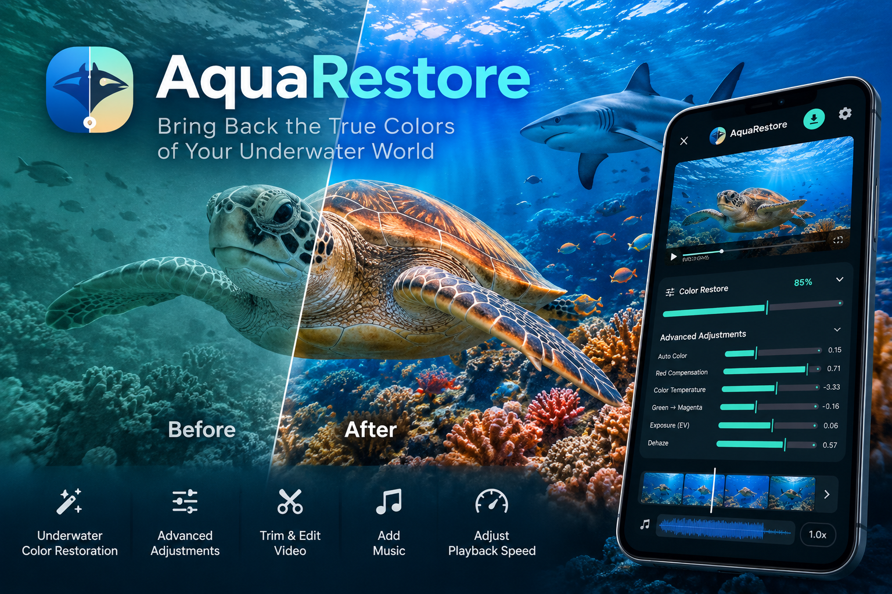

[English](README.md) | **繁體中文**

# AquaRestore

原生 Android 水下影片／圖片色彩還原 App。Kotlin、Jetpack Compose、Media3、OpenGL ES；Android 10（API 29）以上。所有影像處理均在裝置上完成。正式版僅為檢查更新及使用者要求下載更新而使用網路。Debug 版只有在設定區域網路更新時才有網路權限。

[`ios/`](#ios-版本) 另有畫面、操作與色彩流程相同的 iOS 版：SwiftUI、AVFoundation、Metal；iOS 16 以上。

## 使用流程

1. 從 App 內的「最近」或「相簿」選擇影片或圖片。開啟媒體庫時，Android 會要求媒體存取權限；支援的系統版本可只授權選取的照片與影片。
2. 自動分析色彩，推薦紅色補償、白平衡、曝光、去霧、清晰度及陰影設定。
3. 拖動「還原強度」滑桿微調；它會同時調整所有進階參數，0% 為原色，100% 為完整推薦校正。按住「對比原片」顯示原色，鬆開恢復。預覽右上角的 ⛶ 可開啟全螢幕檢視（沿用同一個播放器，播放不中斷），全螢幕中仍可按住對比；再按一次或按返回鍵即可回到編輯畫面。
4. 預覽固定在上方，調整區獨立捲動。影片可展開「影片速度」與「剪輯長度」：剪輯列以已調色的影格縮圖顯示整段影片，範圍外變暗並顯示播放位置；拖動起點／終點時預覽暫停在該影格；在框內點按或拖動可移動游標並停在該影格，游標上方會出現「設為起點／設為終點」，可精準從該影格開始或結束，放開後只在剪輯範圍內循環播放，匯出與檔案大小估算也只計算剪輯範圍。「音訊」可調整原聲音量（0% 為靜音）並加入背景音樂：音樂條顯示整首歌的音量波形，高亮窗口長度自動等於影片輸出長度，左右拖動選擇播放片段，放開後從剪輯起點試聽；原聲與音樂音量分開調整，可保留兩者或只播放音樂。音樂比影片短時會重複播放。可展開進階調整：自動色階、紅色補償、色溫、綠／洋紅偏色、曝光、去霧、清晰度、對比、飽和度、陰影。
5. 上方工具列：左側 ✕ 關閉編輯並返回首頁（會先確認），右側為更換素材、匯出與設定圖示。可選擇「建議」、「原始」或「自訂」匯出，顯示準備／編碼／儲存進度，可取消，支援背景匯出與通知。
6. 在設定切換中文／English、Light／Dark；語言與主題預設均跟隨系統，選擇會持久儲存。

## 智慧推薦與流暢預覽

推薦採用裝置端色彩統計，而非需要雲端的生成式模型。影片抽取 6 個分布於片長 5%–95% 的影格一併分析，整段影片共用一組參數，避免逐幀白平衡跳動。分析會區分深藍／深綠水域、泛白混濁水域與低光畫面，並分別給出建議設定。低信心畫面會顯示提示並降低預設強度；仍可手動微調。

分析完成後，影片通常直接播放原始檔並以 GPU 即時調色。裝置能流暢解碼時，4K60 也可直接播放。需要將 HDR 轉為預覽格式、裝置無法流暢播放原片，或影片長邊超過 3840px 時，App 會製作 1080p、最多 30fps 的預覽副本。必須等待副本才能播放時，畫面會顯示可調色、可定位的靜態影格及製作進度。匯出**永遠使用原始 URI**，不使用預覽副本。

圖片預覽長邊 720px，背景執行調色，每張預覽完成後立即取最新滑桿設定；不會因連續拖動而一直取消工作、直到放手才顯示結果。圖片與影片採用相同的調色公式。相容裝置會保留 HDR 影片輸出；其他裝置會將 HDR 色調映射後以 SDR 匯出。不同裝置、編碼器及色彩管理可能造成輕微顯示差異。

## 匯出策略

| 選項 | 影片 | 圖片 |
| --- | --- | --- |
| 建議 | 較小的來源保留原始設定；較大的影片限制在 1080p、30fps，並使用平衡的位元率 | 較小圖片保留原尺寸，較大圖片縮小；PNG 來源維持 PNG，其他來源存為 JPEG |
| Original | 保留來源尺寸、原始幀時間戳／可變幀率與來源 codec，優先沿用來源影片位元率（依速度調整），缺少資料時才估算；禁止編碼器自動降級 | 原尺寸，調色後可選最高畫質 JPEG 或無損 PNG |
| 自訂尺寸 | 原尺寸或長邊 3840／2560／1920／1280／960／640，保留比例，不放大 | 同左 |
| 自訂 fps | Original／24／25／30／50／60（不提供高於來源的選項），以抽幀降低平均幀率 | 不適用 |
| Quality | 控制目標位元率，10–100% | JPEG 10–100%，或無損 PNG |
| 輸出 | MP4；自訂 SDR 用 H.264、HDR 用 10-bit HEVC；音訊相容時直接保留 | JPEG／PNG |

色彩校正必須重新編碼影片，**Original 不代表位元級無損**，也不能保證還原海水已完全吸收的色彩。Original 保留幀時間戳；自訂 fps 是接近目標的平均幀率，不做運動插幀或保證固定幀間隔。來源 codec 或尺寸若不受裝置編碼器支援，會明確失敗，可改選自訂 H.264 與較小尺寸。

輸出儲存於 `Movies/AquaRestore` 或 `Pictures/AquaRestore`。先寫入暫存，再以 MediaStore pending 機制發布；失敗與取消會清理本次未完成檔案，且永不覆蓋來源。

## 一鍵建置與發布

```bash
./scripts/build-android-debug.sh
```

輸出 `dist/AquaRestore-debug.apk`，預設執行測試與 Lint。debug 版使用獨立的套件名稱（`com.aquarestore.app.debug`），App 名稱為「AquaRestore Dev」，會與正式版並存安裝而不會覆蓋。

正式 APK 啟動時會靜默檢查 GitHub 最新正式版（最多每六小時一次）。有新版本時，設定齒輪會出現紅點，設定內可點「立即更新」；下載後會驗證發布的 SHA-256，安裝仍需在 Android 中確認。Debug 版設定區域網路更新後可從區域網路檢查更新；未設定時沒有更新功能。獨立的 `playRelease` 版本使用 Google Play 應用程式內更新，沒有 APK 安裝權限；詳見[發布指南](docs/RELEASING.md)。

發布：

```bash
./scripts/release-github.sh --version 1.0.0
```

首次發布會詢問是否建立 AquaRestore 專用簽署金鑰 `~/.aquarestore-signing/aquarestore-release.jks`（alias `release`），建立後請立即連同密碼備份；請勿與其他 App 共用金鑰。若要使用既有金鑰，設定 `AQUARESTORE_KEYSTORE` 與 `AQUARESTORE_KEY_ALIAS`。若要讓安裝舊版（預設為 debug 版）的手機原地升級，執行一次 `./scripts/rotate-signing-key.sh`，之後的 release 會自動附上金鑰輪替 lineage。

密碼會隱藏詢問；腳本完成簽署驗證、版本提交、tag／push 與 GitHub Release，附 APK 和 SHA256SUMS。發布前工作目錄須乾淨；`--dry-run` 只做本地建置驗證。完整設定與選項見 [Android 發布指南](docs/RELEASING.md)。此發布流程僅適用於 Android。

若要移除這些腳本在 macOS 上安裝的工具，執行 `./scripts/uninstall-build-env.sh`；每一項移除前都會先詢問。

## 建置

經過調校的調色核心（場景分析、調色公式與 GPU shader）位於私人儲存庫，以 git submodule 掛載於 `core/`。有存取權時，請以 `git clone --recurse-submodules` 複製，或在既有副本執行 `git submodule update --init`。沒有存取權時，請執行一次 `scripts/use-core-stub.sh`：它會以 `core-stub/` 的基本調色填入 `core/`，讓 App 可以建置與執行，但效果明顯不及正式發布的版本。

使用 Android Studio 開啟 `android/`，安裝 Android SDK 36、JDK 17。命令列設定 `ANDROID_HOME` 或 `android/local.properties` 的 `sdk.dir` 後：

```sh
cd android
./gradlew :app:assembleDebug :app:testDebugUnitTest :app:lintDebug
```

APK：`android/app/build/outputs/apk/debug/app-debug.apk`。Gradle Wrapper、依賴版本及 GitHub Actions 建置流程已隨專案提供。

## iOS 版本

`ios/` 是依照 Android 版逐畫面實作的原生 iOS 版：相同的首頁、含按住對比與全螢幕檢視的預覽、速度、剪輯影格列、音訊與音樂片段列、還原強度與進階滑桿、匯出對話框、設定、字串（中文／English）以及淺色／深色配色。調色公式、自動推薦、匯出尺寸與位元率策略、音樂片段規則均為同一份邏輯逐行移植，並由同一組單元測試（`ios/Tests`）涵蓋。

| | Android | iOS |
| --- | --- | --- |
| 介面 | Jetpack Compose、Material3 1.4、Material Icons、Media3 播放控制列 | SwiftUI，依相同規格重建：相同的 Material 圖示（由原始碼產生）、Material3 1.4 的按鈕、標籤、滑桿、進度條、對話框與字級，以及 Media3 的播放控制列 |
| 即時預覽 | ExoPlayer＋GLSL shader | AVPlayer＋自訂 `AVVideoCompositing` 內的 Metal compute shader（與圖片路徑的調色結果相差不超過 1 階） |
| 匯出 | Media3 Transformer | `AVAssetReader` → 同一個 Metal 合成器 → `AVAssetWriter`（H.264／HEVC，位元率與預估大小使用同一份計畫） |
| 圖片 | `ImageDecoder` 解碼，CPU 調色 | ImageIO 解碼，CPU 調色 |
| 匯入 | App 內「最近」／「相簿」媒體庫，需媒體存取權限 | 媒體使用照片選擇器，音樂使用「檔案」 |
| 輸出 | `Movies/AquaRestore`、`Pictures/AquaRestore` | 相簿（僅新增權限，App 不會讀取相簿） |

平台造成的差異：

- **背景匯出：** 此 iOS 16+ 版本不在前景時會暫停匯出，匯出期間螢幕保持喚醒。iOS 26 以上在相容裝置上可藉由 Background GPU Access 權限持續使用 GPU，但此版本尚未設定該能力。
- **沒有預覽代理檔。** 高負載素材（例如 4K60）直接播放；仍需在目標裝置驗證流暢度。
- **音訊：** 未編輯的 AAC 音訊在 iOS 直接保留；變速、調整音量或混入音樂時會編碼為 AAC。其他來源音訊也會編碼為 AAC，以符合 MP4 相容性。
- **Original 影片編碼：** iOS Original 僅保留 AVC 或 HEVC 編碼類別，其他編碼格式請選自訂 H.264／HEVC。兩個平台的 Original 影格時間均依來源軌道決定。
- **HDR10+ 中繼資料：** Android 會拒絕可識別的 HDR10+ 格式，因為無法保留動態中繼資料。iOS 匯入目前不會偵測 HDR10+ 中繼資料，因此匯出後可能遺失。
- **Dolby Vision：** iPhone 錄製的相容規格會以 HLG 基礎層調色，並匯出為一般 HLG；Profile 5 會被拒絕。HDR10／PQ 與 HLG 與 Android 相同，皆在 HLG 曲線上調色。
- 系統字型為 SF Pro 而非 Roboto；字級、字重與行高依 Material 字級規範。iOS 沒有返回鍵，全螢幕與編輯畫面使用畫面上的按鈕離開。
- 播放器的設定選單只提供速度。

建置（需要 Xcode 與 [XcodeGen](https://github.com/yonaskolb/XcodeGen)；Xcode 專案由 `ios/project.yml` 產生）：

```bash
./scripts/build-ios-debug.sh              # 測試＋模擬器建置 -> dist/AquaRestore-debug.app
./scripts/build-ios-debug.sh --run        # 另外在模擬器安裝並啟動
DEVELOPMENT_TEAM=<team id> ./scripts/build-ios-debug.sh --device
```

與 Android 相同，debug 版有獨立的 Bundle ID（`com.aquarestore.app.debug`），名稱為 **AquaRestore Dev**。要在 Xcode 中開發，請執行 `cd ios && xcodegen generate` 後開啟 `AquaRestore.xcodeproj`。與平台無關的邏輯可單獨以 `cd ios && swift test` 建置與測試。

iOS 程式結構（`ios/AquaRestore`）：

- `Core/`：`ExportPlan.swift`（匯出尺寸與位元率）、`FrameCadence.swift`、`MusicMath.swift`、`Strings.swift`，以及 `Tuning/`（連結至 `core/ios/Core`：含調色公式與強度的 `Grade.swift`，以及 `AutoGrade.swift`）。不含介面或 AVFoundation，可在任何環境單元測試。
- `App/GradeRenderer.swift`：`AVVideoCompositing` 類別，以及預覽與匯出共用的影片合成；Metal shader 本身位於 `core/ios/App/GradeShader.swift`。
- `App/MediaIO.swift`、`Soundtrack.swift`、`PlayerController.swift`、`EditorModel.swift`、`Exporter.swift`：對應 Android 同名檔案。
- `App/EditorView.swift`、`PreviewView.swift`、`Panels.swift`、`Timeline.swift`、`Dialogs.swift`：畫面，對應 `MainActivity.kt`。
- `App/Theme.swift`、`MaterialIcons.swift`、`PlayerControls.swift`、`Logo.swift`：Material3 元件、Material 圖示（以 `ios/scripts/make-material-icons.py` 重新產生）、Media3 風格的播放器與標誌圖形。

iOS 已驗證與仍需真機驗收的項目見[驗證紀錄](docs/VALIDATION.md#ios)。

## 目前範圍與限制

- 支援 SDR，以及相容裝置上的 HDR10／PQ、HLG。保留 HDR 需要 Android 13+ 與 Media3 認可的 10-bit HDR 編碼器。缺乏合適 HDR 編碼器的裝置會將 HDR 影片色調映射後以 SDR 匯出；支援 HDR 匯出的裝置在「原始」與「自訂」模式均會保留 HDR。
- 以 `onFallbackApplied` 攔截 Media3 自動 tone-map，並禁止靜默 codec／尺寸降級。HDR 預覽亮度取決於實體螢幕支援；模擬器不能取代 HDR 真機驗收。
- Dolby Vision 與可辨識的 HDR10+ 動態 metadata 格式尚未實作完整保留，會拒絕匯入。HDR10+ 若容器未標識動態 profile，僅靠 track 格式不一定能辨識；本版本不承諾動態 metadata 保留。調色後的 HDR 靜態 mastering／content light metadata 亦未重新測量。
- 去霧使用有上限的黑位／對比校正，清晰度為小範圍亮度銳化；不是深度估計、空間去散射或機器學習去噪。
- 推薦依全片樣本產生；對多場景拼接片段、非常暗的畫面與強烈彩色燈光，建議用強度滑桿確認效果。採關鍵影格抽樣，極短素材可能重複抽到同一影格。
- 暫存需要額外儲存空間。高解析度圖片受記憶體限制；匯出時若記憶體不足，會顯示錯誤，不會偷偷縮圖。
- 不保留圖片 EXIF／GPS／原始容器中繼資料；PNG Original 可能比來源 JPEG 大很多。來源音訊受 MP4 容器相容性限制。
- 背景匯出使用前景服務與 wake lock；系統強制終止或裝置重啟後不自動恢復工作。Android 對長時間背景服務的時限仍適用。
- 流暢度取決於裝置；無法保證所有舊裝置無掉幀。請依 `docs/DEVICE_TESTS.md` 做目標手機實測。

實際已完成與待真機驗收項目見 [驗證紀錄](docs/VALIDATION.md)。

## 程式結構

- `core/android/main`：`AutoGrade.kt`（影格色彩統計與自動推薦）、`Grade.kt`（調色公式與強度縮放）與 `GradeShader.kt`（GPU shader）。
- `ExportPlan.kt`：解析度與位元率策略。
- `UnderwaterEffect.kt`：單通道 GPU 效果、跨執行緒參數快照。
- `FrameCadence.kt` / `FrameRateCap.kt`：時間軸抽幀，維持目標平均 fps 與來源時間戳。
- `MediaIO.kt`：素材資訊、抽樣、圖片解碼與 Media3 Transformer 封裝。
- `EditorModel.kt`：匯入、按需製作預覽副本、預覽與偏好狀態。
- `Soundtrack.kt`：背景音樂片段、音量處理（最高 200%，削波而非溢位）與波形。
- `ExportService.kt`：背景匯出、進度、取消、MediaStore 儲存。
- `MainActivity.kt` / `Strings.kt`：Compose 介面、繁中／英文與主題。

HDR 能力依據：[Media3 支援格式](https://developer.android.com/media/media3/transformer/supported-formats)。精確行為以專案鎖定的 Media3 1.9.3 原始碼與目標裝置驗證為準。

### 強度與影片速度

進階滑桿顯示目前強度下實際套用的數值，會隨總強度移動；手動調整時以目前強度換算回基礎值。「還原強度」滑桿範圍為 0%（原色）至 100%（完整推薦校正），圖片與影片使用相同的強度設定。

影片可選 0.5×、1×、2×、4×，同時套用預覽及匯出，音訊變速保留音高。匯入新素材回到 1×。加速時以均勻抽幀維持來源幀率，例如 60fps 的 4× 仍輸出 60fps（不會變成 240fps）；慢動作無法憑空產生影格，0.5× 的 60fps 輸出約 30fps。匯出對話框的 fps、自訂 fps 選項與檔案大小估算依同一規則。自訂 fps 在變速後抽幀，不插幀。變速音訊需要重新編碼。

影片匯出選項會依目前解析度、fps、畫質及速度即時顯示預估 MB／GB；估算包含音訊與少量容器開銷，實際大小可能因編碼器與畫面複雜度而不同，不是硬性大小上限。Original 不再取來源位元率與高品質公式的較大值，避免不必要的膨脹；相同位元率也不代表重新編碼完全無損。

## 授權

AquaRestore 採用 [PolyForm Strict License 1.0.0](LICENSE) 授權。簡要說明：

- **允許：** 閱讀原始碼，並自行建置及使用本 App 作個人、非商業用途。非營利機構（例如慈善團體、學校、公共研究或政府機構）亦可使用。
- **不允許：** 以任何形式發布或散布本 App 或其原始碼，包括在 Google Play、App Store 或任何其他商店上架免費 App、分享 APK，以及任何商業用途。
- **不允許：** 製作修改版本或基於本原始碼的新作品。

以 [LICENSE](LICENSE) 的完整條文為準，本摘要僅供參考。如需其他用途（例如發布或商業合作），請透過 [GitHub 上的 daocha](https://github.com/daocha) 聯絡。

**本專案不接受外部貢獻。** Pull request 將不予合併並直接關閉；歡迎以 issue 回報問題或提出建議。

App 使用的第三方函式庫（例如 AndroidX Media3、Jetpack Compose）仍適用其各自的授權條款。
